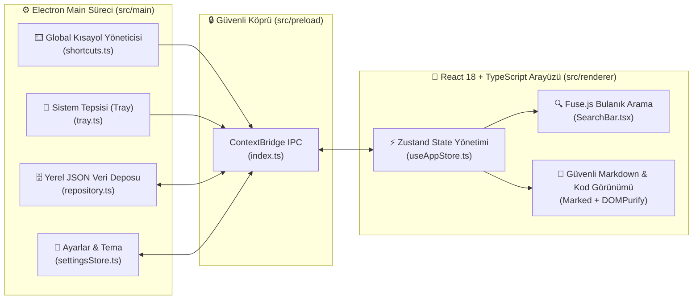

<div align="center">

# 🔐 Solution Vault

**IT Uzmanları ve Yazılım Mühendisleri İçin Global Kısayolla Açılan, Çevrimdışı (Offline) Hata & Çözüm Bilgi Bankası**  
*A Premium Dark-Mode Desktop Knowledge Base & Spotlight-Style Launcher for IT Specialists and Developers*

[](https://www.electronjs.org/)
[](https://react.dev/)
[](https://www.typescriptlang.org/)
[](https://tailwindcss.com/)
[](LICENSE)

</div>

---

## 🌟 Genel Bakış (Overview)

> **"Hatayı yakala. Çözümü kaydet. Kariyerinin geri kalanında saniyeler içinde tekrar bul."**

**Solution Vault**, sistem yöneticileri, DevOps mühendisleri ve yazılım geliştiricilerin karşılaştıkları karmaşık hata mesajlarını, terminal komutlarını ve çözüm adımlarını **tamamen çevrimdışı (offline)** olarak saklayıp saniyeler içinde tekrar bulmalarını sağlayan **launcher tarzı** bir masaüstü uygulamasıdır.

Arka planda sistem tepsisinde (System Tray) sessizce bekler; global bir klavye kısayoluyla (`Ctrl+Shift+Space` / `Alt+Space`) anında ekranın ortasında belirir, **Fuse.js** bulanık arama (fuzzy search) motoruyla binlerce kayıt arasından aradığınız çözümü bulur ve tek tuşla kod bloğunu panoya kopyalamanızı sağlar.

---

## 🏗️ Mimari (Architecture)



---

## ✨ Öne Çıkan Özellikler (Highlights)

- **⚡ Launcher Ergonomisi (Global Hotkey):** Hangi uygulamada veya terminalde olursanız olun global kısayolla anında çağrılır ve işiniz bittiğinde `Esc` ile gizlenir.
- **🔍 Anlık Bulanık Arama (`Fuse.js`):** Hata başlığı, semptomlar, çözüm adımları, komutlar ve etiketler (`tags`) üzerinde milisaniyeler içinde ağırlıklı arama yapar.
- **📝 Zengin Markdown ve Tek Tıkla Kod Kopyalama:** `marked` ve `DOMPurify` (XSS korumalı) ile biçimlendirilmiş çözüm notları ve her kod bloğu için tek tıkla panoya kopyalama düğmesi.
- **📦 Dışa / İçe Aktarma (JSON Backup & Restore):** Bilgi bankanızı tek tıkla dışa aktarıp yedekleyebilir veya başka bir bilgisayara taşıyabilirsiniz.
- **🛡️ %100 Çevrimdışı ve Güvenli:** Hiçbir telemetri veya bulut zorunluluğu yoktur. `contextIsolation: true` ve `sandbox` ilkeleriyle güvenli Electron IPC mimarisi kullanır.

---

## ⌨️ Klavye Kısayolları (Keyboard Shortcuts)

| Kısayol | İşlev |
|---|---|
| `Alt + Space` / `Ctrl + Shift + Space` | Solution Vault penceresini her yerden aç / gizle |
| `Ctrl + K` / `/` | Arama çubuğuna odaklan |
| `Ctrl + N` | Yeni hata/çözüm kaydı oluştur |
| `Ctrl + E` | Seçili kaydı düzenle |
| `Esc` | Açık modalı kapat veya pencereyi tepsiye gizle |

---

## 🚀 Kurulum ve Çalıştırma (Getting Started)

```bash
# 1. Bağımlılıkları kurun
npm install

# 2. Geliştirici modunda başlatın (Hot-Reload)
npm run dev

# 3. TypeScript tip kontrolü
npm run typecheck

# 4. Windows (.exe) kurulum paketi oluşturun
npm run build:win
```

---

## 📂 Proje Dizini (Project Structure)

```text
Solution-Vault/
├── src/
│   ├── main/                    # Electron ana süreci (Pencere, Tray, Global Kısayollar, Veri Deposu)
│   ├── preload/                 # Güvenli ContextBridge IPC tanımları
│   ├── renderer/                # React 18 + Tailwind CSS + Framer Motion kullanıcı arayüzü
│   └── shared/                  # Main ve Renderer arasında paylaşılan TypeScript veri modelleri
├── docs/                        # İçe ve dışa aktarma şema belgeleri
├── electron.vite.config.ts      # Electron-Vite derleme yapılandırması
└── electron-builder.yml         # Çoklu platform (Win/Mac/Linux) paketleme ayarları
```

---

## 📄 Lisans (License)

Bu proje **MIT Lisansı** altında lisanslanmıştır.
